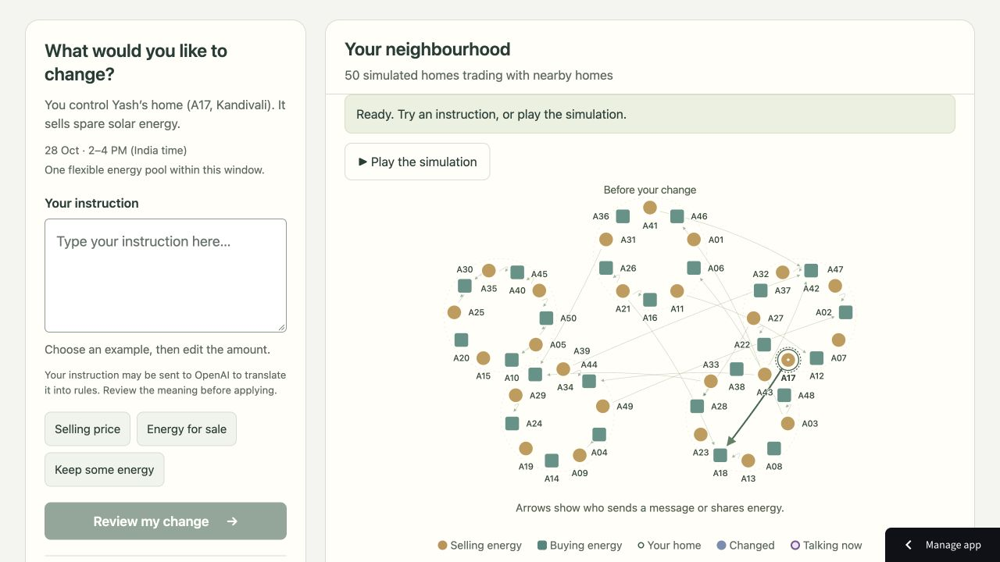

# Collective energy exchange

A visual sandbox for studying how one household's requirements change negotiations across a synthetic energy market. Built on [Energy Exchange Lab](https://github.com/dhruvsarkar/energy-exchange-lab), with a collective negotiation engine and interactive workspace.

[Open the hosted workspace](https://energy-exchange-collective.streamlit.app/).



## Try it

The workspace starts with 50 homes in five neighbourhoods. You control Yash's home, A17. Choose an example or write a requirement, review the proposed rules, and confirm the change. Clicking another home opens its details without changing which home you control.

```text
Sell up to 4 kWh from 2 to 4 PM at at least ₹7/kWh; accept ₹6.50 only if at least 3 kWh is sold together.
```

Follow the recorded result through starting agreements, the revised requirement, the directly affected agreement, offers and responses, and the final allocation. Each change uses the original baseline and the same household strategies. Detailed results compare traded energy, unmet demand, payments, messages, and household gains or losses. Downloads include experiment records, events, and trades.

The default method uses bargaining with recorded price strategies. When configured, OpenAI prepares those strategies and helps translate instructions. Clear supported instructions use a free grammar path. The workspace reports rules-based fallback when the model is unavailable, and asks for clarification when a requirement is ambiguous. Every change needs confirmation.

## Run locally

```bash
python3 -m venv .venv
.venv/bin/python -m pip install -r requirements-collective.txt
.venv/bin/python -m src.energy_exchange.collective_server --port 8766
```

Open http://127.0.0.1:8766. On macOS, `./Start-Collective.command` sets up the environment and starts the server. The workspace runs without an API key using rules-based fallback. See [the run guide](README-COLLECTIVE.md) for server-only API configuration and Streamlit deployment.

## Scope and evidence

All homes and trades are synthetic. The engine checks energy totals, reserves, budgets, price rules, delivery overlap, and permitted replacements. Energy is a flexible total over each home's delivery window, with no hourly capacity model. No electricity or money is transferred.

A locally stable result applies only to the recorded strategy and bounded bilateral moves. It does not establish a Nash equilibrium, a global optimum, or physical grid feasibility. The workspace also compares bargaining with the midpoint method on the same generated world, with each method forming its own starting allocation.

The [run guide](README-COLLECTIVE.md) explains assumptions, validation, exports, and cost controls. [Verification evidence](docs/evidence) records checked scenarios and results. GitHub Actions runs collective and legacy checks.

The collective engine uses NandaTown concepts without importing its runtime. The [original six-household lab](README-LEGACY.md), including its NandaTown integration and meter-supported settlement, remains available through `streamlit_app.py`.

Claude Fable 5.1 with Ultracode reviewed the source PDF and engine. The Codex team implemented the refined negotiation flow, policy interface, services, visual workspace, integration, and verification.
